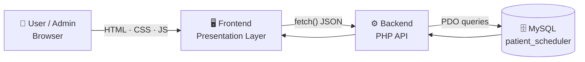
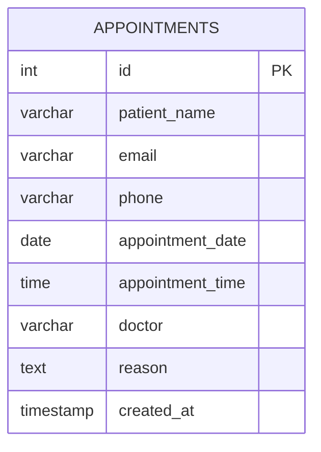

<div align="center">


<br>


**A simple, fast and user-friendly web app that replaces manual hospital registers with a structured MySQL database.**

[Features](#-features) · [Tech Stack](#-tech-stack) · [Architecture](#-architecture) · [Installation](#-installation) · [API](#-api-reference) · [Screenshots](#-screenshots) · [Team](#-team)

</div>

---

## 📖 About the Project

Traditional appointment booking in hospitals and clinics is slow, error-prone and hard to track.
The **Patient Appointment Scheduling System** digitises the process: patients book appointments online,
and administrators can view, edit and delete records from a single dashboard.

The project demonstrates core **Database Management System** concepts: tables, primary keys,
normalization, data retrieval and full **CRUD** operations.

## ✨ Features

| | Feature | Description |
|---|---|---|
| 📝 | **Book Appointment** | Enter name, email, phone, date, time, doctor and reason |
| 📋 | **Admin Dashboard** | View all appointments in a sorted, tabular format |
| ✏️ | **Edit Appointment** | Update any appointment detail instantly |
| 🗑️ | **Delete Appointment** | Remove completed or incorrect records with confirmation |
| ✅ | **Validation** | Server-side checks for required fields and valid email |
| 🔒 | **Secure by Design** | PDO prepared statements (SQL-injection safe) and output escaping (XSS safe) |
| ⚙️ | **Auto Setup** | Database and table are created automatically on first run |
| 📱 | **Responsive UI** | Clean layout that works on desktop and mobile |

## 🛠️ Tech Stack

| Layer | Technology |
|---|---|
| **Frontend** | HTML5, CSS3, JavaScript (Fetch API) |
| **Backend** | PHP (PDO), JSON REST-style API |
| **Database** | MySQL via phpMyAdmin |
| **Server** | Apache (XAMPP / WAMP) |

## 🏗️ Architecture

Three-tier architecture: Presentation → Application → Database.



### Database Schema



## 📂 Project Structure

```
patient-appointment-scheduling-system/
├── backend/
│   ├── api/
│   │   ├── create_appointment.php
│   │   ├── get_appointments.php
│   │   ├── get_appointment.php
│   │   ├── update_appointment.php
│   │   └── delete_appointment.php
│   ├── config/
│   │   ├── db_connect.php
│   │   └── helpers.php
│   └── database/
│       └── schema.sql
├── frontend/
│   ├── css/style.css
│   ├── js/
│   │   ├── api.js
│   │   ├── booking.js
│   │   ├── appointments.js
│   │   └── edit.js
│   ├── index.html
│   ├── appointments.html
│   ├── edit.html
│   └── about.html
├── assets/banner.svg
├── screenshots/
├── LICENSE
└── README.md
```

## 🚀 Installation

### Prerequisites
- [XAMPP](https://www.apachefriends.org/) (Apache + MySQL + PHP) or WAMP/MAMP
- A modern web browser

### Steps

```bash
# 1. Clone the repository
git clone https://github.com/<your-username>/patient-appointment-scheduling-system.git

# 2. Move it into your web server folder
#    Windows: C:\xampp\htdocs\      Linux: /opt/lampp/htdocs/
```

3. Start **Apache** and **MySQL** from the XAMPP Control Panel.
4. *(Optional)* Import `backend/database/schema.sql` in phpMyAdmin. If you skip this, the database is created automatically.
5. If your MySQL has a password, edit `backend/config/db_connect.php`.
6. Open in your browser:

```
http://localhost/patient-appointment-scheduling-system/frontend/index.html
```

> ⚠️ Open the app through `localhost`. Double-clicking the HTML files will not work because the frontend calls the PHP backend.

## 🔌 API Reference

Base path: `backend/api/`

| Method | Endpoint | Description | Body / Params |
|---|---|---|---|
| `POST` | `create_appointment.php` | Create an appointment | JSON: `patient_name, email, phone, appointment_date, appointment_time, doctor, reason` |
| `GET` | `get_appointments.php` | List all appointments | - |
| `GET` | `get_appointment.php?id=1` | Get one appointment | `id` |
| `POST` | `update_appointment.php` | Update an appointment | JSON: `id` + appointment fields |
| `POST` | `delete_appointment.php` | Delete an appointment | JSON: `{ "id": 1 }` |

**Sample response**
```json
{
  "success": true,
  "message": "Appointment successfully booked.",
  "id": 7
}
```

## 📸 Screenshots

| Booking Page | Appointment Dashboard |
|---|---|
|  |  |

| phpMyAdmin Structure | Database Records |
|---|---|
|  |  |

## 🔮 Future Enhancements

- [ ] Login authentication for admin and patients
- [ ] Email / SMS appointment reminders
- [ ] Separate **Patient** and **Doctor** tables with foreign keys
- [ ] Prevent double-booking of the same doctor and time slot
- [ ] Online consultation (video call) support

## 👨‍💻 Team

| Name |
| **Kishore S** |
| **Sanjai B** |
| **Sibidharan R** |

## 📄 License

Distributed under the MIT License. See [`LICENSE`](LICENSE) for details.

<div align="center">

⭐ If you found this project useful, please give it a star!

</div>
